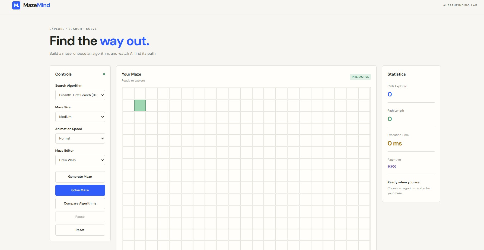
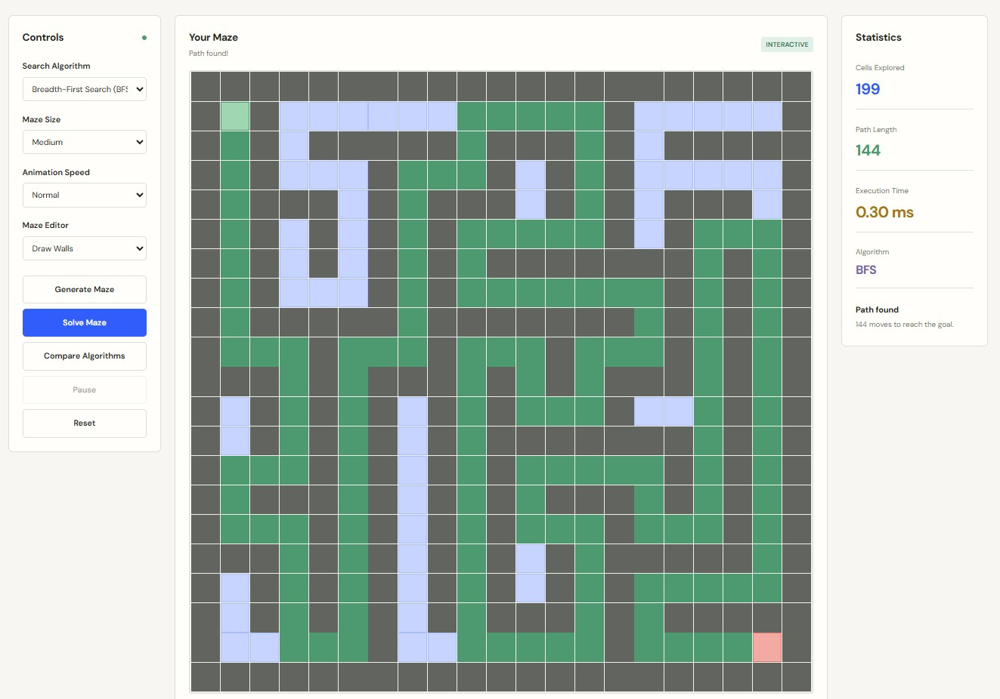
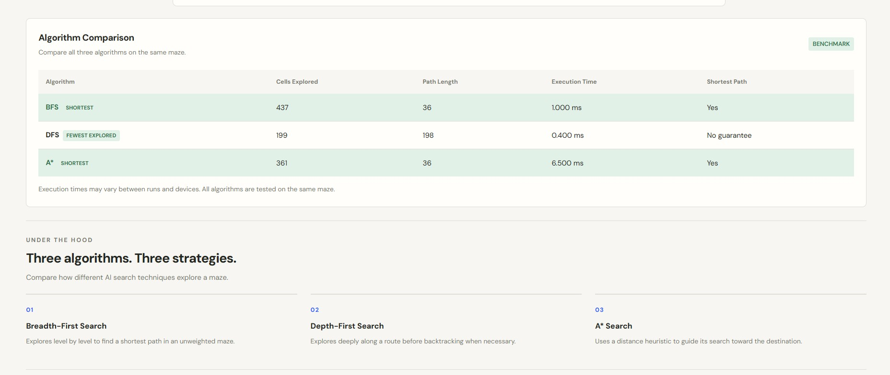

# MazeMind — AI Maze Solver 🧠

MazeMind is an interactive web application that visualizes how Artificial Intelligence search algorithms solve mazes. Users can create and edit mazes, select a search algorithm, watch the exploration process, and compare algorithm performance.

## Screenshots

### Main Interface


### Maze Solved


### Algorithm Comparison



## ✨ Features

- **Interactive Maze Editor:** Draw and erase walls, and move the start and goal positions.
- **Random Maze Generation:** Generate mazes using a randomized depth-first search technique.
- **Three Search Algorithms:** Visualize BFS, DFS, and A* pathfinding.
- **Animated Visualization:** Watch cells being explored and the final path being discovered.
- **Algorithm Comparison:** Compare explored cells, path length, and execution time.
- **Performance Statistics:** View results for the selected algorithm.
- **Responsive Design:** Use the application on desktop and mobile screens.

## 🛠️ Technologies Used

- HTML5
- CSS3
- JavaScript

MazeMind runs entirely in the browser and does not require a backend or database.

## 🧩 Algorithms

| Algorithm | Description |
|---|---|
| Breadth-First Search (BFS) | Explores cells level by level and guarantees a shortest path in an unweighted maze. |
| Depth-First Search (DFS) | Explores deeper along a route before backtracking. It does not guarantee a shortest path. |
| A* Search | Uses path cost and a Manhattan-distance heuristic to guide the search toward the goal. It guarantees a shortest path for this maze configuration. |

## 🚀 Getting Started

### Prerequisites

- A modern web browser
- Git (optional, for cloning the repository)
- Visual Studio Code (recommended)

### Installation

Clone the repository:

```bash
git clone https://github.com/adityabhandekar77-dev/MazeMind.git
```

Open the project folder:

```bash
cd MazeMind
```

### Running the Application

Open `index.html` in your browser, or open the project in Visual Studio Code and use the Live Server extension.

No additional dependencies or build steps are required.

## 🎮 How to Use

1. Generate a maze or edit the existing grid.
2. Choose BFS, DFS, or A* from the algorithm selector.
3. Adjust the maze size and animation speed if needed.
4. Click **Solve Maze** to watch the algorithm explore the grid.
5. Use Pause and Reset to control the visualization.
6. Click **Compare Algorithms** to compare the results on the same maze.

## 📁 Project Structure

```text
MazeMind/
├── index.html
├── css/
│   └── style.css
├── js/
│   ├── algorithms.js
│   └── script.js
├── assets/
├── screenshots/
└── README.md
```

## 📊 Understanding the Results

- **Cells Explored:** Number of cells processed during the search.
- **Path Length:** Number of moves from the start to the goal.
- **Execution Time:** Approximate time taken to execute the search algorithm.
- **Shortest Path:** Indicates whether the algorithm guarantees a shortest path under the current maze rules.

Execution times may vary depending on the device and browser. The number of explored cells and the selected maze can also affect the results.

## 🎯 Project Objective

MazeMind demonstrates fundamental Artificial Intelligence search techniques through an interactive and visual learning experience. It helps users understand how different algorithms explore a state space and find paths toward a goal.

## 👨‍💻 Author

**Aditya Bhandekar**

GitHub: [adityabhandekar77-dev](https://github.com/adityabhandekar77-dev)

---

*MazeMind — Explore. Search. Solve.*